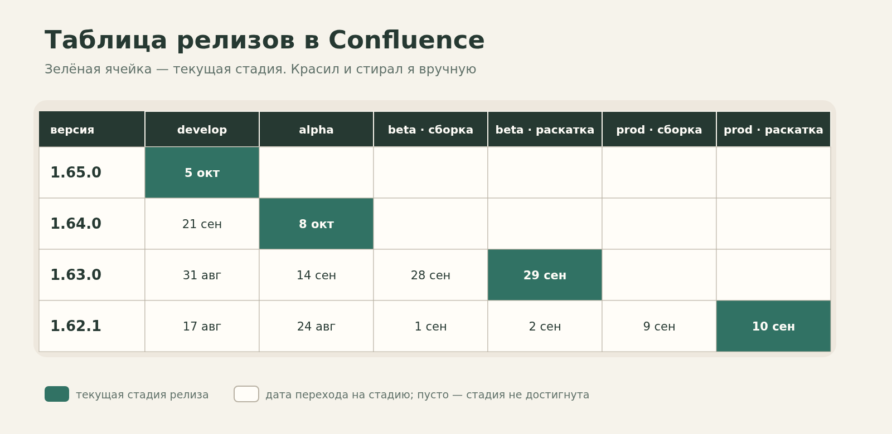
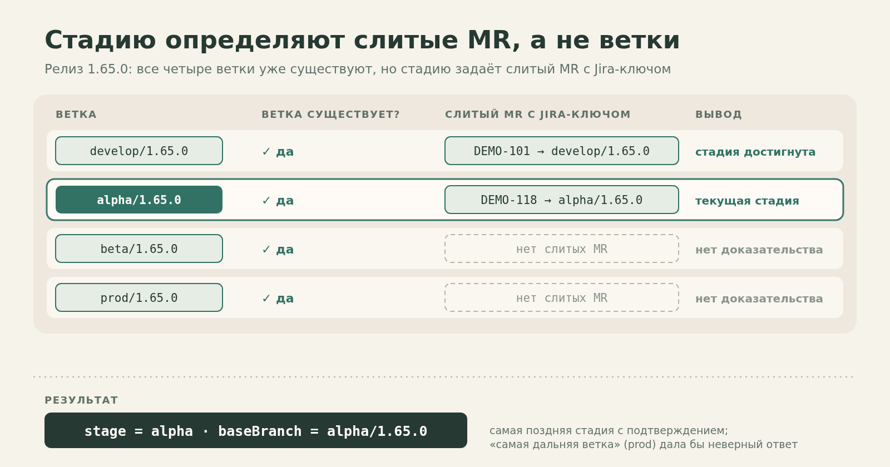
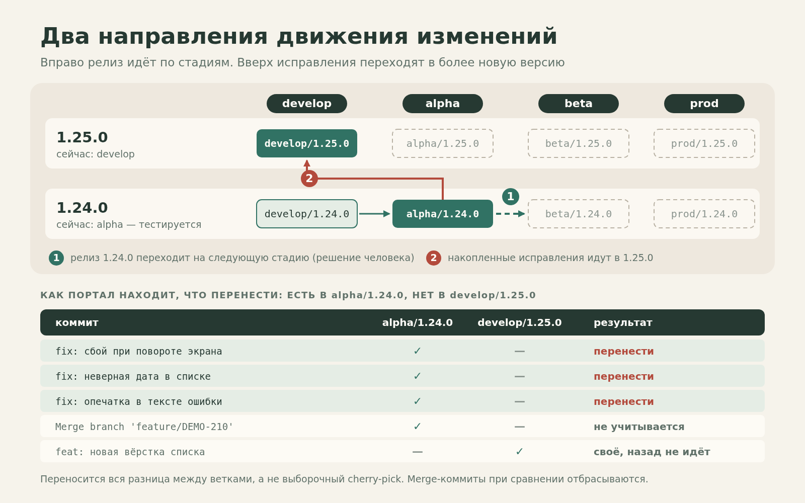
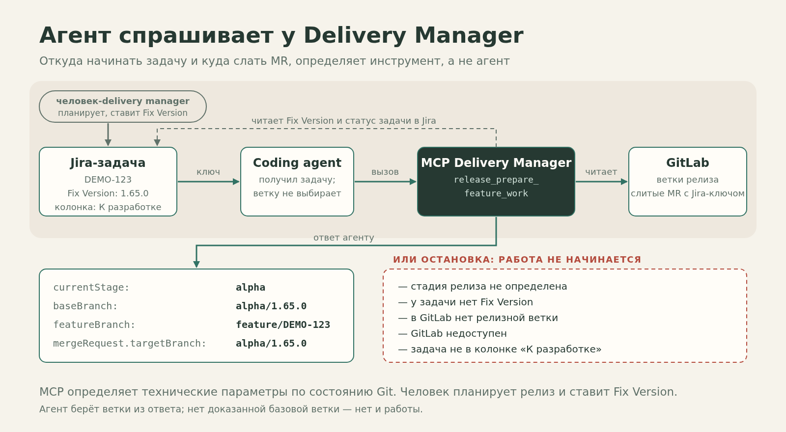
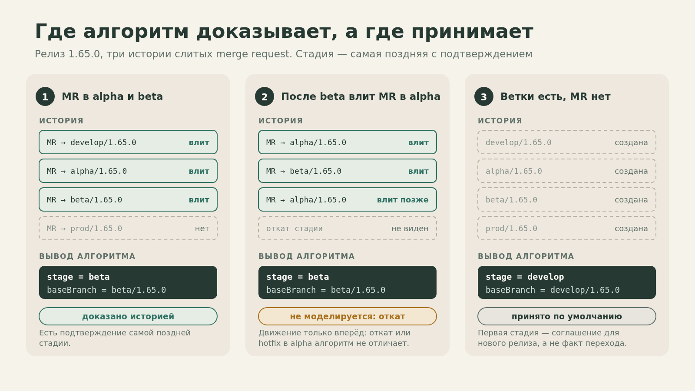

# Мой Git Flow, часть 3. Я перестал красить ячейки в Confluence: стадию релиза теперь считают портал и MCP

В [первой части](https://hram.github.io/articles/hram-git-flow-base/) этой серии я рассказывал, как организую релизные ветки и почему считаю планирование релизов ответственностью менеджмента, а не разработчиков. Во [второй](https://hram.github.io/articles/hram-git-flow-ci/) — как превратил правила работы с Git, Jira и CI/CD в автоматические проверки.

Но оставался вопрос, на который все эти регламенты и скрипты не отвечали:

**В какой стадии прямо сейчас находится конкретный релиз?**

Вроде бы мелочь. Есть ветки `develop/1.65.0`, `alpha/1.65.0`, `beta/1.65.0`, `prod/1.65.0`. Есть GitLab, история merge request, проверки и автоматическая сборка. Однако наличие четырёх веток ещё не означает, что релиз прошёл все четыре стадии: все они создаются сразу при заведении релиза.

На практике ответ знали люди, которые постоянно работали над проектом. Нужно было присутствовать на дейликах, следить за тестированием, смотреть, что и куда вливают. Чтобы не потерять картину, я завёл таблицу в Confluence. Позже появились два инструмента: веб-портал, который показывает состояние релизов мне, и MCP Delivery Manager, который отвечает на вопросы coding agent.

Оба выросли из одной мысли: **если продвижение релиза оформляется через Git, то состояние релиза уже можно восстановить по истории Git. Необязательно хранить его ещё и в голове человека.**

## Зелёная ячейка, которую приходилось красить вручную

В моём Git Flow у каждого релиза своя цепочка веток. Например:

```text
develop/1.65.0 → alpha/1.65.0 → beta/1.65.0 → prod/1.65.0
```

Стадии — не универсальный список для всех команд. Для Android-приложения это может быть `develop → alpha → beta → prod`, для backend — `develop → test → stage → prod`. Разработка отделена от распространения; сколько понадобится этапов распространения, зависит от продукта.

При этом несколько версий живут одновременно. Одна разрабатывается, другая тестируется, третья уже проходит бета-этап, четвёртая находится на production. В старой статье я объяснял, зачем это нужно и почему исправления из младших версий обязательно должны попадать в старшие.

А вот следить за всей этой картиной было неудобно.

Я сделал обычную таблицу Confluence: строки — номера релизов, столбцы — стадии и операции. Когда релиз переходил на следующий этап, я вписывал дату, снимал зелёную заливку с одной ячейки и закрашивал другую. Так было хотя бы видно, где находится каждая версия.



Проблема не в том, что таблица была сложной. Проблема в том, что её достоверность зависела от меня. Если я забыл обновить запись, она больше не отражала реального состояния. А сам процесс продвижения релизов от этой таблицы никак не зависел.

Получалась странная ситуация: GitLab уже фиксировал действия, после которых я открывал Confluence и вручную записывал, что эти действия произошли.

В какой-то момент я задал себе вопрос: **зачем я переписываю информацию из одного инструмента в другой, если её можно вычислить?**

## Что считать доказательством перехода стадии

Здесь важно не перепутать существование ветки и состояние релиза.

При заведении нового релиза сразу создаются ветки всех стадий. Поэтому алгоритм «найди самую позднюю существующую ветку» не работает. `prod/1.65.0` существует с первого дня, даже если релиз только начали разрабатывать.

Нужен другой сигнал — действие, которым по нашему регламенту оформляется продвижение релиза.

У нас таким действием служит **слитый merge request в ветку соответствующей стадии**. Целевая ветка имеет имя `<stage>/<version>`, а MR связан с Jira-задачей. Например, если в `alpha/1.65.0` был влит соответствующий MR, это доказательство достижения стадии `alpha`. Если позднее такой MR появился в `beta/1.65.0`, релиз дошёл до `beta`.

В реализации Delivery Manager логика устроена так: инструмент находит слитые MR с Jira-ключом в заголовке, имени ветки или описании, сопоставляет целевые ветки с релизом и порядком стадий и выбирает **самую позднюю стадию, для которой есть такое доказательство**.

```text
Релиз 1.65.0

Ветка                 Есть подтверждающий merged MR?

develop/1.65.0        да
alpha/1.65.0          да                 ← текущая стадия
beta/1.65.0           нет
prod/1.65.0           нет

Результат: stage = alpha, baseBranch = alpha/1.65.0
```



Это не универсальное свойство Git. Это **наше определение состояния релиза**, которое работает благодаря заранее принятому регламенту. Если команда меняет стадии другим способом, ей потребуется другое доказательство.

Причём эту формулировку я излагаю уже задним числом. Сначала у меня была идея избавиться от таблицы. Формальный алгоритм и его ограничения оформились в ходе создания инструментов.

## Портал вместо таблицы

Я Android-разработчик, немного занимался backend, но никогда не писал веб-порталы. Идея удобной визуализации релизного процесса у меня была давно. Довести её до реализации получилось, когда появились coding agents.

Сначала я довольно долго обсуждал задумку в ChatGPT: объяснял Git Flow, таблицу Confluence и существующие проверки. В результате получил промпт на реализацию, который передал coding agent. Так начал появляться мой `gitlab-panel`.

Я хотел получить аналог старой таблицы, но не просто в более красивом интерфейсе. Мне нужно было, чтобы он **сам строил картину по данным GitLab**.

Для этого пришлось описать проекты, наборы стадий, релизы, историю их переходов. Затем появились импорт релизов из GitLab и собственно матрица. В марте 2026 года в git-истории проекта уже видны импорт переходов на основе merge request, а позднее — матрица со стрелками и межрелизными связями.

Подробную историю разработки портала я оставлю для отдельного материала. Здесь важнее, что получилось с точки зрения релизного процесса.

В матрице строки — версии, столбцы — стадии. Сразу видно, что один релиз ещё разрабатывается, другой на тестировании, третий приближается к production. Между стадиями расположены стрелки, показывающие состояние переноса изменений.


Особенно мне нравится, что матрица показывает **два направления движения изменений**.

Первое — горизонтальное: внутри одного релиза изменения идут от разработки через стадии распространения до production.

Второе — между версиями. В моём Git Flow, если баг исправили в более раннем релизе, это исправление обязательно должно попасть в более новый. Иначе старая ошибка вернётся в следующем выпуске.

Раньше это правило существовало как обязанность команды. Теперь портал умеет проверять его по Git: сравнивать ветки соседних релизов и находить коммиты, которые присутствуют в младшей версии, но отсутствуют в старшей. Merge-коммиты при таком сравнении отфильтровываются.

Например, `1.24.0` ещё тестируется, а разработка `1.25.0` уже идёт. В `1.24.0` исправили несколько ошибок и после завершения проверки перевели её на следующую стадию. Исправления должны перейти в `1.25.0`; разработку новой версии останавливать из-за этого не нужно. Если перенос ещё не сделан, вертикальная связь в матрице показывает проблему.



Мне больше не требуется вручную восстанавливать, не забыл ли я пролить исправления вперёд. Расхождение видно непосредственно на схеме.

## Нажал на стрелку — получил MR на проливку

Но просто показать разницу недостаточно. Если портал знает, **откуда** и **куда** нужно перенести изменения, почему бы не поручить ему рутинную часть операции?

Так появился мастер «проливки» — у нас этим словом называют перенос изменений между стадийными ветками или между релизами. Он состоит из двух шагов.

Сначала портал показывает источник, целевую ветку и состав переносимых изменений. Я вижу, что именно собираюсь сделать, и подтверждаю действие.

Затем начинается исполнение. Портал использует существующую Jira-задачу на проливку или создаёт подзадачу под указанной стори, заполняет необходимые поля и переводит задачу в `CodeReview`. Если переход статуса не удался, процесс останавливается. Далее создаётся временная `feature/<KEY>` от исходной стадийной ветки, а из неё — merge request в целевую.

В MR добавляется список коммитов, которые планируется перенести. Для такой проливки мы **не включаем squash**: нам важно сохранить историю изменений, по которой потом можно проверять движение коммитов между релизами. Портал также пытается включить merge после успешного pipeline, записывает ссылку на MR и список изменений в комментарий Jira и показывает, что проливка находится в работе.

Важно: это не означает, что любое нажатие гарантированно завершится merge. Автоматическое слияние зависит от состояния pipeline и возможностей GitLab; отдельные шаги могут требовать внимания.


Здесь мне принципиально важно сохранить разграничение ответственности из первой статьи. **Портал не решает, пора ли релизу переходить в следующую стадию.**

Когда разработка закончена и я отвечаю за передачу релиза на тестирование, решение принимаю я. После тестирования решение принимает соответствующая роль: тестировщик сообщает о готовности, delivery manager планирует дальнейшее продвижение и создаёт задачу на проливку. Я получаю эту задачу и запускаю техническое исполнение.

Если задача уже создана delivery manager, мастер использует её номер. Если инициатор проливки я сам, можно указать стори, и портал создаст подзадачу. **Ответственность за решение осталась у человека; автоматизированы действия, которые следуют после решения.**

Сегодня я пользуюсь порталом именно для такой работы: создать релиз, посмотреть состояние, перенести изменения по стадиям или между версиями. Мне для этого больше не требуется вручную открывать GitLab и выполнять последовательность git-команд.

## Вторая проблема: coding agent тоже не знал, где находится релиз

Параллельно изменился мой обычный процесс разработки. Значительную часть задач я стал выполнять через coding agents. И внезапно обнаружил, что та же проблема с текущей стадией возникла снова — только теперь по другую сторону диалога.

Раньше я говорил агенту примерно следующее:

> Обнови `develop/1.65.0`. Создай от неё `feature/<ключ задачи>`. Реализуй задачу. Потом сделай MR в `develop/1.65.0`.

Но завтра этот же релиз мог оказаться уже в `alpha`, а ещё через какое-то время — в `beta`. Значит, мне самому приходилось знать текущую стадию и каждый раз подсказывать агенту правильные ветки.

Именно от этого я только что избавился с помощью портала — для себя. Получалось нелепо: **для человека стадия уже вычислялась, а агент продолжал получать её с моих слов**.

Я не хотел, чтобы агент догадывался о состоянии релиза по локальному checkout, выбирал default branch или заучивал особенности каждого проекта в промпте. Ему нужен был инструмент, который отвечает на конкретный вопрос: **откуда начинать работу над этой Jira-задачей и куда потом отправлять MR?**

Так появился MCP-инструмент, который я назвал **Delivery Manager**.

Название может ввести в заблуждение. Он не заменяет реального delivery manager. Человек по-прежнему планирует релизы и указывает Fix Version в Jira. MCP не выбирает, когда выпустить фичу. Он получает уже запланированную задачу и определяет, как с ней работать в существующем релизном процессе.

## От алгоритма в портале — к инструменту для агента

Портал и Delivery Manager — разные проекты с разными кодовыми базами. Я не стал делать MCP зависимым от работающего портала.

Когда понадобился Delivery Manager, я попросил агента, который занимался порталом, объяснить, где именно в исходниках лежит алгоритм определения стадии: файлы, методы, логика. Полученную справку передал другому агенту, разрабатывавшему MCP. Тот перенёс доменную идею в новый инструмент.

Это важная деталь: сейчас две реализации существуют отдельно. Они опираются на один регламент и историю GitLab, но **автоматической синхронизации кода между ними нет**.

В MCP порядок стадий проекта устанавливается по его релизным веткам и известным названиям стадий, затем фиксируется в настройках пространства. В портале для этого есть отдельные экраны. Это компромисс, который я принял при переносе логики.

Для агента контракт получился небольшим. В Jira-задаче человек уже указал Fix Version. По проекту, версии и ключу задачи MCP обращается к GitLab, определяет текущую стадию и возвращает готовые параметры для работы.

Например, схематично ответ может выглядеть так:

```yaml
# Вымышленный пример; сокращённая иллюстрация контракта,
# не буквальный JSON-ответ MCP.
fixVersion: 1.65.0
currentStage: alpha
baseBranch: alpha/1.65.0
baseBranchExists: true
featureBranch: feature/DEMO-123
mergeRequest:
  targetBranch: alpha/1.65.0
```

Иными словами, агенту не нужно понимать, почему `1.65.0` сегодня на `alpha`. Достаточно получить проверенный `baseBranch` и целевую ветку MR.



Эти значения могут подставляться и в шаблоны дальнейшей работы как `{{baseBranch}}`, `{{featureBranch}}`, `{{mergeRequestTargetBranch}}`. Но сам механизм исполнения таких шаблонов — отдельный инструмент, о котором я здесь рассказывать не буду. Для этой статьи важнее, **откуда берутся значения**.

Я сформулировал для агента жёсткое правило: **он не выбирает базовую релизную ветку самостоятельно. Единственный источник — Release MCP**.

Если у задачи нет Fix Version, текущую стадию нельзя определить, нужная ветка отсутствует или GitLab недоступен, работа не должна продолжаться наугад. Есть и проверка готовности самой задачи: например, задача не в статусе «К разработке» — значит, нельзя считать её подготовленной к реализации.

У меня был вполне приземлённый случай: я сам забывал перевести задачу в нужный статус, и работа останавливалась. Это не ошибка инструмента. Он сделал именно то, чего я от него добивался: **отказался обходить регламент ради того, чтобы любой ценой начать писать код**.

## Где здесь остаётся человек — и где алгоритм может ошибиться

Хочется сказать, что теперь всё работает само, но это было бы неправильным выводом.

Во-первых, правила релизного процесса по-прежнему задают люди. Delivery manager планирует версии и состав релиза. Ответственные за стадии решают, когда переводить релиз дальше. Я определяю, какие действия инструментам разрешены, что считать доказательством стадии и в каких случаях нужно остановиться.

Во-вторых, вычисление состояния опирается на допущения. В текущей реализации их три.

**Стадия определяется по самому дальнему подтверждённому переходу.** Если есть merged MR в `beta/<version>`, алгоритм считает, что релиз дошёл до `beta`. Он не пытается восстановить произвольную бизнес-логику из названий задач.

**Релиз движется только вперёд.** В моей модели не предусмотрен откат версии из `beta` обратно в `alpha`. Поэтому самый поздний подтверждённый этап остаётся текущим. Если в другой команде возможны официальные откаты стадий, такой алгоритм уже недостаточен.

**Если подтверждающих MR пока нет, считается первая существующая стадия.** Это важно для только что созданного релиза: все его ветки уже созданы, но ещё ни одной проливки не было. Мы принимаем, что он находится в начальной стадии. Это осознанный fallback, а не доказанный факт перехода.



Есть и инженерные ограничения. У портала и MCP две отдельные реализации алгоритма, поэтому изменение правил придётся согласованно переносить между ними. Проверка стадии не стала частью старого `jira:check` из второй статьи: теперь её делают другие инструменты. И я не измерял, на сколько часов сократилось сопровождение релизов, поэтому не буду обещать здесь проценты экономии времени.

Зато изменился конкретный участок моей работы, который легко описать без цифр. **Раньше я сам помнил стадию релиза, обновлял таблицу, объяснял ветки человеку или агенту и выполнял последовательность действий в GitLab. Теперь состояние можно получить из истории, портал показывает расхождения, а агент спрашивает MCP вместо того, чтобы спрашивать меня.**

## Что изменилось за три части

Когда я впервые внедрял этот Git Flow, мне было важно разграничить ответственность. Разработка не должна вручную перекраивать релизы из-за проблем с планированием. Ветвление и правило продвижения изменений целиком помогали удерживать эту границу.

Потом я устал следить за тем, выполняют ли люди договорённости, и начал переносить проверяемые правила в GitLab CI/CD. Это была вторая часть истории.

Но одного регламента и автоматических проверок оказалось мало. Между ними оставалось знание, которое никто не формализовал: **где релиз находится сейчас**. Я долго держал его в Confluence и собственной голове, а затем обнаружил, что ответ уже содержится в истории нашего процесса.

В третьей части этот ответ впервые стал доступен инструментам: порталу — чтобы показывать релизную матрицу и помогать с проливками, MCP — чтобы coding agent не выбирал ветки наугад.

Для меня здесь главное не то, что агент написал веб-интерфейс и MCP-сервер. До появления coding agents я просто не брался за веб-портал: это была не моя специализация. Агенты дали возможность довести давно задуманную идею до работающего инструмента. Но само определение релизного процесса, критерии его состояния и границы ответственности появились задолго до них.

Теперь, когда я говорю агенту «реализуй задачу», мне не нужно одновременно выступать справочником по текущим стадиям всех релизов. Мне достаточно, чтобы задача была правильно подготовлена, а у агента был инструмент, которому можно задать нужный вопрос.

**И если инструмент не может обоснованно ответить, правильное действие — остановиться, а не угадать.**

