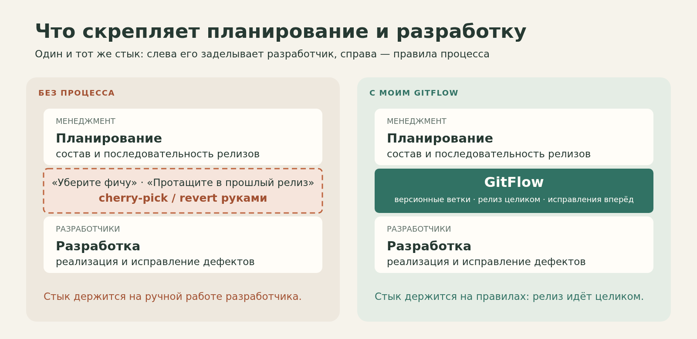
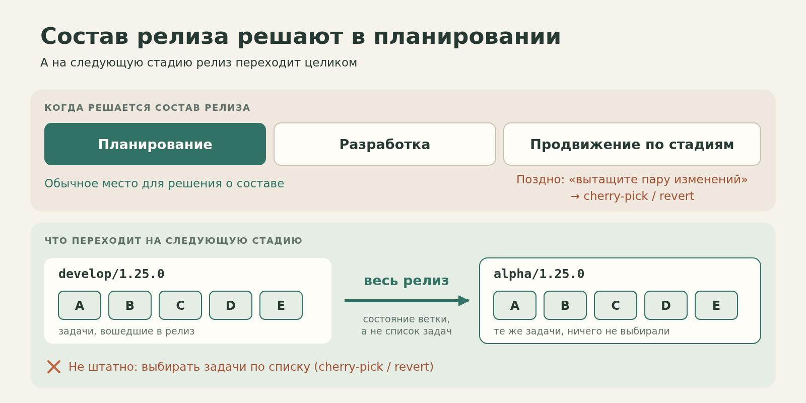
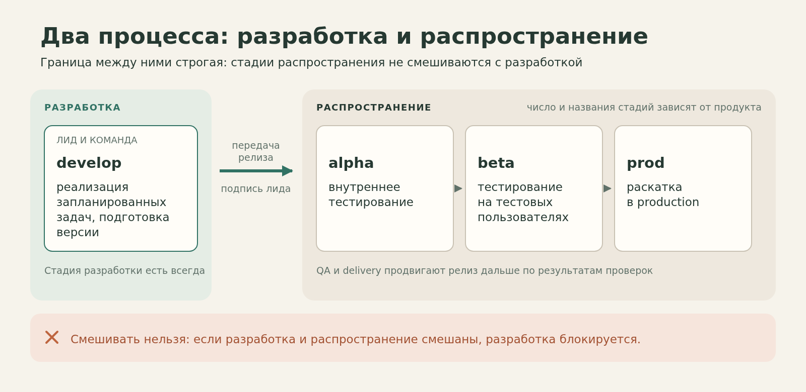
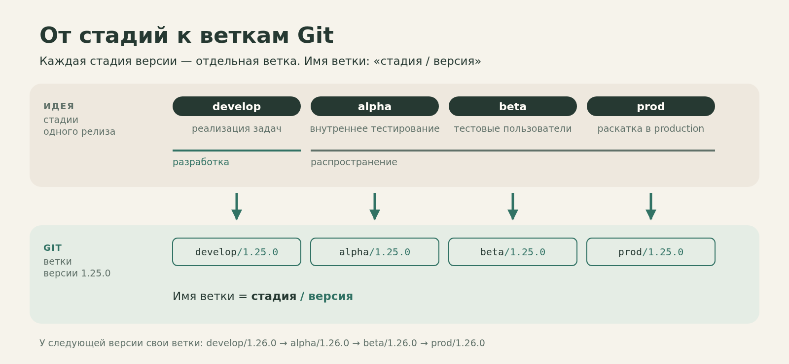
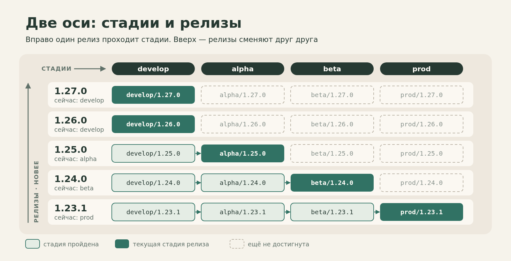
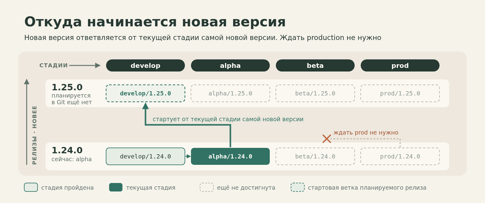
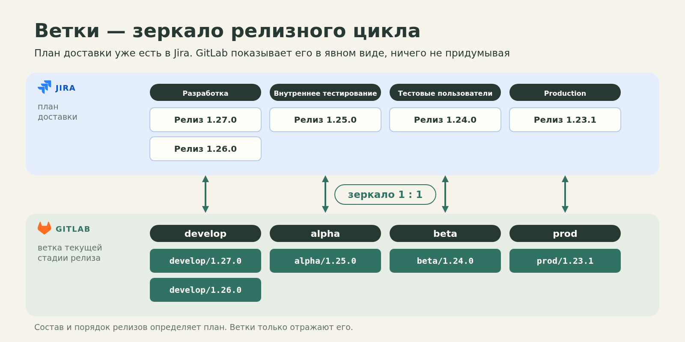
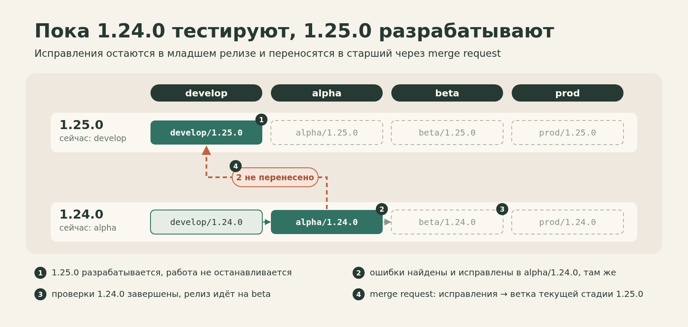
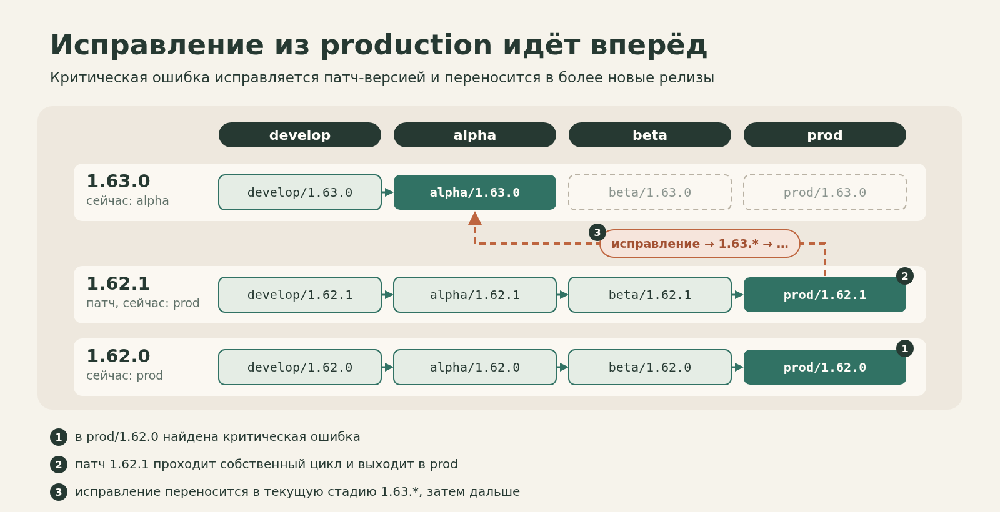

# GitFlow как цемент между планированием и разработкой



*Версионные ветки, параллельные релизы и простое правило: проблемы релизного планирования не должны автоматически становиться проблемами разработчиков.*

«Эту фичу пока не выпускаем. Уберите её из релиза». «А эту, наоборот, надо срочно протащить в предыдущую версию». В какой-то момент такие просьбы становятся привычной частью разработки. Нужно найти коммиты, сделать `cherry-pick` или `revert`, проверить зависимости, разобраться, что случайно задели, и заново собрать нужный состав релиза.

Сами Git-команды здесь ни при чём. Иногда они действительно нужны. Меня всегда беспокоило другое: почему последствия решений о составе и сроках релиза по умолчанию исправляет разработчик?

За годы работы я замечал, что при слабой организации релизного процесса эта ответственность постепенно переезжает к программистам. Не запланировали вовремя, передумали, не учли зависимость, не договорились о сроках — значит, разработчик сейчас что-нибудь соберёт из коммитов.

Больше десяти лет на разных проектах и в разных компаниях я использую свой вариант GitFlow, в котором стараюсь не допускать такой ситуации.

## Релиз нужно планировать, а не пересобирать в последний момент

Основная идея моего подхода довольно жёсткая: **менеджмент должен планировать последовательность релизов и определять их объём**. Как назвать эту роль — продукт, релиз-менеджер, delivery или руководитель — не так важно. Важно, чтобы ответственность не исчезала между должностями.

Разработка отвечает за реализацию задач и качество кода. Но разработчики не должны регулярно подбирать коммиты под изменившиеся планы выпуска.

Именно поэтому в моём процессе **релиз продвигается целиком**. Когда мы переводим его с одной стадии на следующую, мы переносим состояние релиза, а не выбираем из него отдельные задачи по списку.

Это не значит, что состав релиза нельзя обсуждать или менять. Это значит, что обычное место для такого решения — планирование, а не момент, когда код уже собран и кто-то просит разработчика вытащить из него пару изменений.



## Два независимых процесса: разработка и распространение

Первое важное разделение — разработка и распространение.



Стадия разработки есть всегда. Условно назовём её `develop`. Здесь команда реализует запланированные задачи и готовит следующую версию.

А дальше начинается другой процесс: проверка, допуск и распространение релиза. Сколько у него стадий и как они называются, зависит от продукта. Где-то достаточно `test → stage → prod`. Где-то нужны `alpha → beta → prod`. Где-то цепочка длиннее.

Разработчику необязательно разбираться в устройстве каждой фазы распространения, чтобы начать работать над следующей версией. Для этого существуют команды и роли, которые отвечают за тестирование, готовность и выпуск.



Например, один из возможных маршрутов выглядит так:

```text
develop/1.25.0 → alpha/1.25.0 → beta/1.25.0 → prod/1.25.0
```

Это не четыре общие ветки на весь проект. Это четыре стадии конкретной версии `1.25.0`. У следующей версии будут свои ветки, например:

```text
develop/1.26.0 → alpha/1.26.0 → beta/1.26.0 → prod/1.26.0
```

и так далее.

Появление кода в следующей ветке само по себе не значит, что релиз готов или выпущен. Решение о продвижении принимают ответственные за стадию люди, опираясь на проверки.

За передачу из разработки в первую стадию распространения в моём процессе отвечаю я как лид разработки. Для нас эта передача — подпись. Мы отдаём релиз в тестирование только тогда, когда вся запланированная функциональность реализована, покрыта тестами и мы сами убедились, что она работает. Этим мы говорим: всё, что было запланировано, сделано в полном объёме, можно тестировать.

А если что-то всё-таки не успели? В норме так быть не должно, но страховка есть: вся новая функциональность у нас разрабатывается за feature flags. Недоделанная фича может спокойно доехать до production — она просто не будет включена. Вырезать её из релиза через `revert` не нужно.

Дальше вступают QA и delivery: они проводят свои проверки и определяют, можно ли двигаться дальше.

Так у релиза появляется не только номер версии, но и текущее состояние — стадия, до которой он дошёл.

## Несколько версий живут одновременно

Представьте, что сейчас картина такая:

```text
Версия    Текущая стадия
1.27.0    develop
1.26.0    develop
1.25.0    alpha
1.24.0    beta
1.23.1    prod
```

Это не авария и не исключение. Это нормальная работа конвейера.

`1.23.1` уже выпущен. `1.24.0` раскатана на тестовых пользователей, `1.25.0` проходит внутреннее тестирование. `1.26.0` и `1.27.0` ещё в разработке: в них команда делает новые задачи. Каждый релиз существует в своей цепочке, но все они относятся к одному продукту.

Пять строк в таблице взяты для наглядности. В реальной работе одновременно живут три-четыре версии: одна на beta, следующая на внутреннем тестировании, ещё одна в активной разработке. Иногда функциональность готова уже на один-два релиза вперёд.



В этом месте часто возникает вопрос: откуда создавать следующий релиз, если предыдущий ещё не дошёл до production?

У меня правило такое: **новая версия ответвляется от текущей стадии самой новой версии**.

Если самая новая версия — `1.24.0` и она находится в `alpha`, то новый `develop/1.25.0` начинается от `alpha/1.24.0`. 
Если самая новая версия — `1.65.0` на `beta`, то `develop/1.66.0` создаётся от `beta/1.65.0`.

Не нужно ждать `prod/1.24.0`, чтобы начать работу над `1.25.0`. И не нужна одна вечная ветка `develop`, в которой перемешивается разработка всех будущих релизов.



Дальше я буду называть «младшей» версию с меньшим номером, а «старшей» — с большим: `1.24.0` младше `1.25.0`.

У такого подхода есть очевидное следствие: новая разработка может начаться от версии, которая ещё проходит проверки. Это осознанное решение. Если позже в младшей версии обнаружатся ошибки, их нужно будет исправить там и затем перенести вперёд. Именно для этого существует правило наследования, о котором ниже.

## Чем это отличается от классического Git Flow

Я по привычке называю свою модель GitFlow, но с классической моделью Винсента Дриссена её лучше не путать.

В классическом Git Flow есть одна постоянная ветка `develop`. Это ветка следующего релиза: фичи вливают в неё, когда решено, что они пойдут в ближайший выпуск, а для стабилизации от неё отделяют release-ветку. Пока релиз один, схема работает хорошо, и я не считаю её плохой.

Вопросы начинаются, когда план длиннее одного релиза. Для релиза N+2 в такой схеме нет места: его фичи либо лежат в feature-ветках и ждут, пока отделится release-ветка предыдущего релиза, либо их вливают в общий `develop` вперемешку. Я много раз видел оба варианта. В первом ветки отстают от кодовой базы и обрастают конфликтами. Во втором `develop` перестаёт отражать что-то определённое, а если фичу в итоге не выпускают, её приходится откатывать. Это не дефект модели Дриссена, а следствие того, что у неё есть место ровно для одного будущего релиза.

Я делаю наоборот. План доставки у продукта уже есть: какие релизы, в каком порядке и на какой стадии. Он живёт в трекере, у меня это Jira. Я не придумываю для Git отдельную схему, а отражаю этот план в ветках один к одному: у каждого релиза своя цепочка веток, каждой стадии соответствует своя ветка, а стадия релиза на доске определяет, какая из его веток сейчас актуальна.



Ветки здесь не отдельная конструкция поверх процесса, а зеркало плана доставки: его слепок в явном виде. Из этого следует несколько практических вещей:

- Следующему релизу не нужно ждать. Как только он появился в плане, у него есть своя `develop/<версия>`, и разработчики вливают в неё сразу.
- Состав релиза виден по самой ветке: в `develop/1.25.0` лежит то, что запланировано на `1.25.0`, а не всё, что успели влить.
- Вопрос «что откатить» возникает редко, потому что состав определяется планом заранее, а недоделанную функциональность прячут за feature flag.

Цена у этого есть. Версии изолированы по составу, но не независимы: исправление, сделанное в младшей версии, нужно перенести во все старшие, и конфликты при этом разрешают разработчики. Об этом правиле ниже.

И зеркало не делает план лучше. Если план хаотичный, ветки покажут тот же хаос. Разница в том, что он будет виден в ветках сразу, а не прятаться в очереди из feature-веток, ждущих своего релиза.

## Пока тестируют 1.24.0, команда уже делает 1.25.0

Вот реальная ситуация из моего проекта.

Мы создали `develop/1.25.0` и начали работу над новыми задачами. В это время предыдущая версия `1.24.0` ещё находилась на стадии `alpha`.

Тестировщики нашли ошибку. Возможно, найдут ещё несколько — для процесса это ничего принципиально не меняет.

Что делать? Остановить разработку `1.25.0` до тех пор, пока `1.24.0` окончательно не доедет до production? Или исправить дефект только в новой версии, оставив старую в неопределённом состоянии?

Ни то ни другое.

Ошибку исправляют там, где её нашли: прямо в `alpha/1.24.0`, на той же стадии того же релиза. QA продолжает проверять этот релиз, чтобы довести его до выпуска. Одновременно разработка `1.25.0` не останавливается.

В нашем сценарии после завершения тестирования `1.24.0` и продвижения на следующую стадию мы явно, через merge request, переносим накопленные исправления в ветку текущей стадии `1.25.0`. Не по одному `cherry-pick`, а слиянием изменений младшего релиза в старший.



Здесь происходят два разных движения изменений, и путать их нельзя.

Первое — горизонтальное: `1.24.0` проходит свои стадии распространения, например `alpha → beta → prod`. 
Второе — между версиями: изменения, сделанные в младшей `1.24.0` после ответвления, должны попасть в старшую `1.25.0`.

Обратите внимание на порядок: в этом примере мы не тащим в новую версию каждую правку сразу после её появления. Сначала завершается проверка младшего релиза. На других проектах контрольные точки могут отличаться, но само требование не меняется: исправления не должны потеряться.

Конфликты при таком слиянии бывают, но, как правило, простые. Они возникают в общих файлах, куда разные релизы дописывают по строке: строковые ресурсы, список feature flag, события аналитики. Две новые строки одна под другой просто остаются обе.

Вот что я считаю настоящей независимостью разработки от распространения. QA спокойно доводит свой релиз до нужного состояния. Разработчики продолжают следующую версию. А связь между ними держится на понятном правиле наследования, а не на ручном подборе отдельных коммитов.

## Исправления должны идти вперёд

Я формулирую это правило так: **исправление, внесённое в младшую версию, обязательно должно попасть во все старшие версии, которые уже от неё ответвились**. Это то самое второе движение изменений: не по стадиям одной версии, а между версиями.

Где проходит граница между «исправить на текущей стадии» и «выпустить hotfix»? У нас — на beta. Beta — это уже раскатка на тестовую группу пользователей, фактически почти релиз. Если важную ошибку нашли на `alpha`, её исправляют прямо там, и релиз идёт дальше. Если её нашли в `beta/1.24.0`, это уже hotfix: исправление делается в новой патч-версии `1.24.1`, которая продолжает путь с beta.

Тот же принцип работает и для критического бага в production.

Допустим, в `prod/1.62.0` обнаружена проблема, которую нельзя ждать до очередного большого релиза. От этой версии создаётся патч-версия `1.62.1`. Исправление проходит в нём собственный цикл проверок и выпуска.

После выпуска исправление переносится в более новые релизы — например, в текущую стадию `1.63.*`, а затем дальше, если более новые версии уже ответвились.



## Почему не cherry-pick и revert — и чего это стоит

За последние пять лет мы, насколько я помню, прибегали к `cherry-pick` и `revert` для изменения состава релиза один или два раза. Бизнес очень просил перенести фичу в более ранний релиз, и мы пошли навстречу. Для меня это нормальная разница между правилом и исключением: иногда запрос стоит того, чтобы отступить от процесса.

Проблема начинается, когда исключение становится способом выпускать продукт. Стоит сделать выборочный перенос штатной процедурой, и у планирования появляется дешёвый обходной путь: «Давайте сначала всё соберём, а потом решим, что выпускать». Пока для этого всегда найдётся разработчик с `cherry-pick`, процессу незачем меняться.

Поэтому у нас наоборот: состав и порядок релизов определяются заранее, релиз идёт целиком, недоделанное прячут за feature flag. Ответственность распределена так:

- **менеджмент** определяет объём и последовательность релизов;
- **лид разработки** отвечает за готовность передать версию на распространение;
- **QA и delivery** отвечают за проверки и решения о продвижении по стадиям;
- **разработчики** реализуют задачи, исправляют дефекты и разрешают конфликты при переносе между версиями.

У подхода есть цена. Нужно вести несколько версий параллельно, не забывать вливать исправления из младших релизов в старшие, договариваться о контрольных точках и редких исключениях. В команде, где состав выпуска принципиально определяют в последний момент, а выборочная поставка изменений — основная бизнес-модель, такой процесс будет неудобен.

Я не утверждаю, что это универсальный рецепт. Я говорю о том, почему он работает для меня и почему я переношу эти правила из проекта в проект больше десяти лет.

## Вместо вывода

Обычно GitFlow обсуждают через названия веток и набор Git-команд. Мне важнее другое.

В продукте есть две работы: планирование релизов и разработка. Их делают разные люди, и обе нужны. Если между ними нет надёжного стыка, его заделывают вручную: просьбами «уберите фичу», `cherry-pick`'ами и `revert`'ами. Платят за это разработчики.

Мой GitFlow — это цемент в этом стыке. Ветки не придуманная схема, а план доставки в явном виде: у каждого релиза своя цепочка, у каждой стадии своя ветка. Поэтому несколько релизов живут одновременно, тестирование старой версии не останавливает разработку новой, а исправления не теряются на пути к следующим версиям.

**Версионные ветки и правила слияния лишь делают договорённость об ответственности видимой. Держится стык на ней.**
