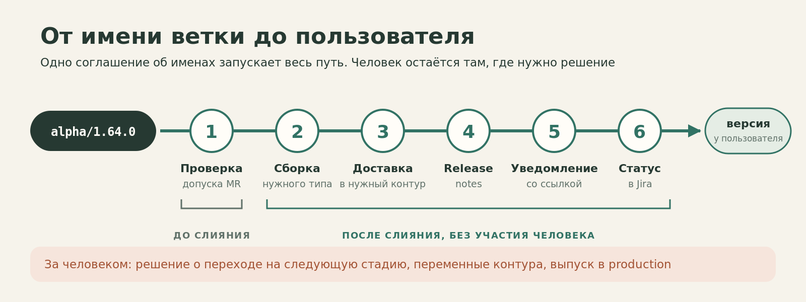
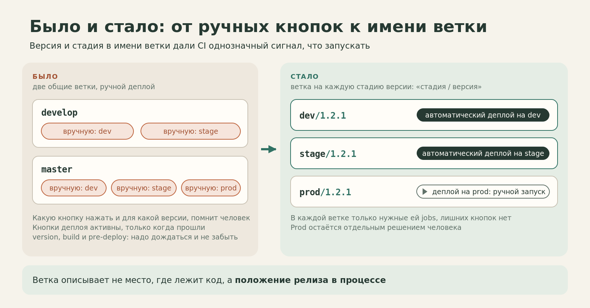
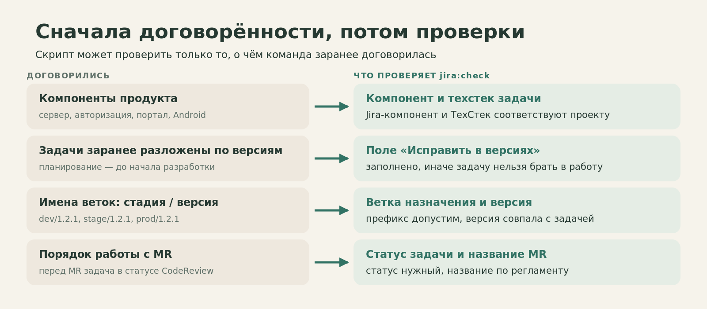
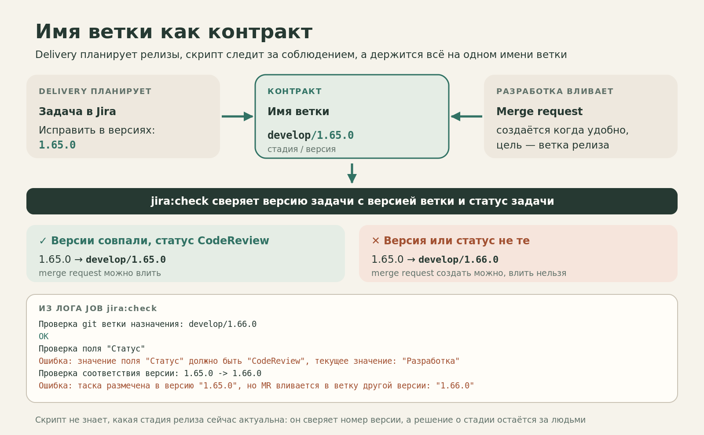
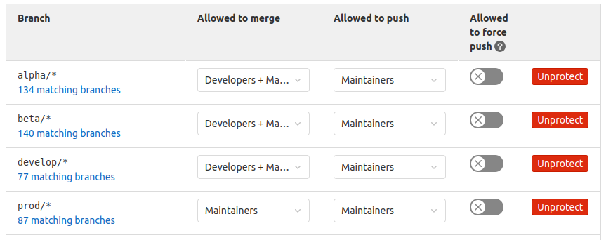
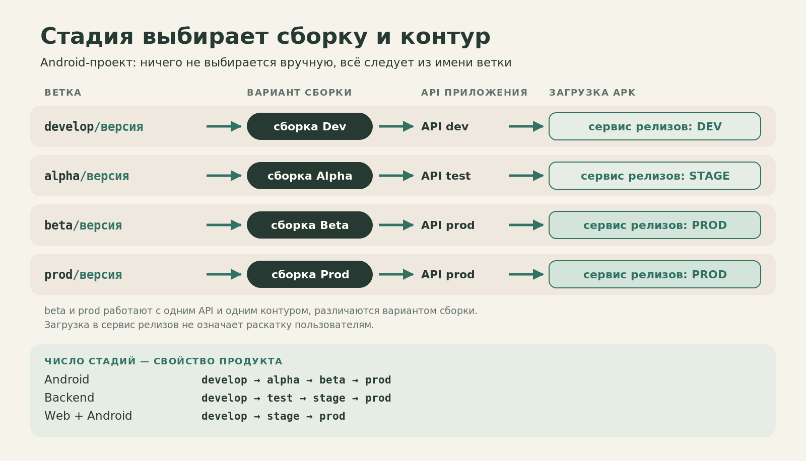
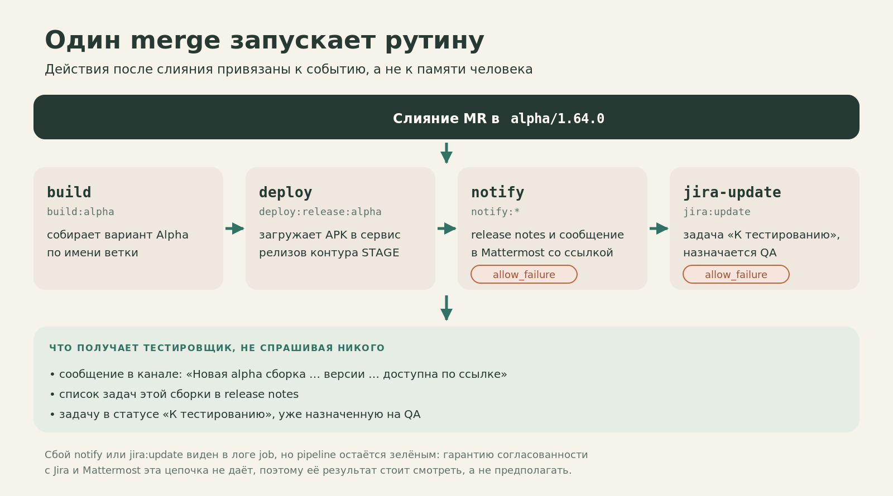
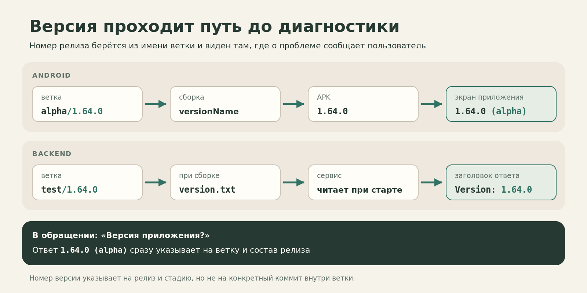

# Мой Git Flow, часть 2. Я устал следить за регламентами и поручил это GitLab

*Как имя версионной ветки стало основой проверок merge request, выбора сборки, доставки, release notes, уведомлений и статусов в Jira.*

В [первой части](https://hram.github.io/articles/hram-git-flow-base/) я рассказал про свой Git Flow — модель, которую использую больше десяти лет. Её идея не столько в названиях Git-веток, сколько в ответственности: релизы должны планировать те, кто отвечает за их выпуск. Разработчикам не нужно каждый день пересобирать состав релиза через `cherry-pick` и `revert` только потому, что кто-то передумал.

Но однажды я столкнулся с проблемой, которую не решить правильной схемой ветвления.

Меня пригласили в проект с другим релизным процессом. Я предложил внедрить свой. Это было не первое внедрение: технически настроить ветки и CI/CD для меня уже не составляло особого труда.

Сложным оказалось другое — добиться, чтобы команда действительно начала работать по договорённым правилам.

Мы согласовывали процесс три раза: я рисовал схемы, рассказывал, куда вливать изменения и кто принимает решение о продвижении релиза. Но на практике правила приходилось объяснять снова и снова: одни не понимали, какую ветку выбирать, другие путали порядок действий, третьи откровенно не хотели их выполнять.

В старой презентации, которую я позже подготовил для коллег, есть фраза: **«Чувствовал себя надзирателем»**. Пожалуй, она точнее всего описывает тот период.

В какой-то момент я решил: если регламент можно проверить программно, не нужно держать человека рядом с каждым merge request. Пусть эту работу делает GitLab.



## Ветки сами по себе ничего не автоматизируют

Когда я пришёл в тот проект, там были привычные `develop` и `master`. Деплой можно было вручную отправить на разные окружения. В `develop` — выбрать dev или stage. В `master` — тоже, плюс prod.

Для каждого выпуска надо было помнить, **какую кнопку нажать и для какой версии**.

К тому же кнопки деплоя становились активными только после того, как пройдут `version`, `build` и `pre-deploy`. Код уже влит, а теперь его надо караулить: открыть пайплайн, дождаться зелёных этапов и не забыть нажать. Фактически сидеть и обновлять страницу.

Имя ветки само по себе не давало CI однозначного ответа.

Я заменил эту конструкцию версионными ветками:

```text
dev/1.2.1
stage/1.2.1
prod/1.2.1
```

Теперь стадия и версия были написаны прямо в имени. Пайплайн мог запускать только нужные для этой стадии действия.



Это не новая технология. GitLab давно умеет запускать jobs по имени ветки. Важнее другое: **теперь ветка описывает не просто место, где лежит код, а положение конкретного релиза в процессе**.

Но у этой идеи есть предварительное условие. Нельзя автоматизировать правила, о которых команда не договорилась.

## Сначала пришлось договориться о правилах

Я начал не со скриптов.

Сначала мы описали компоненты продукта, распределили задачи в Jira, договорились о версионировании, окружениях, именах веток и порядке merge request. В той системе были сервер, сервер авторизации, портал и Android-приложение. Для разных компонентов использовались свои версии: задачи заранее раскладывали по запланированным выпускам.

Это звучит как административная подготовка, которую хочется пропустить и сразу открыть `.gitlab-ci.yml`. Но именно здесь закладывается возможность дальнейшей автоматизации.

Возьмём простую задачу. Если у неё указана **Fix Version `1.64.1`**, разработчик понимает, в какой релиз готовится изменение. Целевая ветка MR тоже содержит `1.64.1`, например:

```text
feature/ISSUE-123 → beta/1.64.1
```

Теперь можно сравнить два значения автоматически: **запланированная версия задачи совпадает с версией целевой ветки или нет?**

Если версия не задана, проверить соответствие невозможно. То есть планирование перестаёт быть необязательной записью где-то в переписке. Оно становится входными данными для разработки.



Из таких договорённостей получается набор проверок, которые выполняются без человека.

## Вместо напоминаний — проверка каждого MR

Регламент был согласован, но мне постоянно приходилось напоминать людям, как оформлять задачи и merge request. Замечания оставлял прямо на ревью. Пока их не исправляли, MR оставался заблокированным.

В итоге я написал `jira:check` — Python-скрипт, который запускается в GitLab CI для merge request.

Он проверяет вполне конкретные вещи:

- по имени feature/bugfix-ветки можно получить ключ Jira-задачи;
- целевая ветка имеет допустимый стадийный префикс;
- задача находится в нужном статусе и у неё заполнены согласованные поля: технический стек, компонент и Fix Version;
- версия в Jira совпадает с номером версии целевой ветки;
- заголовок MR соответствует соглашению об именовании.

Ошибки собираются в отчёт. Если проверка не прошла, соответствующая job завершается с ошибкой; при настроенном требовании успешного pipeline такой MR нельзя влить, не исправив данные.



Сами релизные ветки я дополнительно защищаю через GitLab Protected Branches.

Правила задаются масками: `develop/*`, `alpha/*`, `beta/*`, `prod/*` — в зависимости от проекта. Поэтому новый релиз, например `alpha/1.66.0`, сразу попадает под нужные ограничения.



Слияние в `develop/*`, `alpha/*` и `beta/*` доступно через merge request разработчикам и Maintainers, прямой push — только Maintainers. Для `prod/*` и слияние, и push оставлены Maintainers. Force push выключен везде.

Это продолжение той же мысли. Недостаточно сказать новичку: «Не трогай production-ветку». Если его роль не должна этого позволять, проще и надёжнее закрепить ограничение настройкой GitLab.

Я встречал процессы, где выкладка запускалась постановкой тега на произвольный коммит. В тех проектах, которые я видел, доступ к таким тегам не ограничивали должным образом. Это не недостаток тегов как инструмента: GitLab умеет защищать и теги. Но **в моём процессе событием выпуска служит merge в защищённую ветку нужной стадии**, а права на вливание определяет ролевая модель GitLab.

## Одна договорённость — разные продукты и окружения

На этом месте мой Git Flow начинает приносить отдачу, которая выходит далеко за рамки оформления MR.

Раз ветка называется `<stage>/<version>`, GitLab может определить по ней, **что именно собирать и куда отправлять результат**.

В Android-проекте по ветке выбирается вариант сборки, API, с которым он работает, и контур внутреннего сервиса релизов, куда загружается APK. Вручную ничего выбирать не нужно: всё следует из имени ветки.



И важно, что число стадий — свойство продукта, а не универсальный закон. В backend-проекте у нас цепочка `develop → test → stage → prod`. В другом продукте, который собирается и для web, и для Android, — `develop → stage → prod`. В обоих случаях сохраняется одна и та же основа: стадия и версия в имени ветки задают понятное событие для CI/CD.

Стадия определяет не только вариант сборки. В моих прошлых проектах она определяла даже **форму дистрибутива**. Когда я впервые применял такой подход, примерно в 2013 году, в Windows-приложении, одна ветка давала бинарники для внутреннего тестирования, другая — инсталлятор для отдела контроля качества, production — ISO-образ с программой, документацией и дополнительными материалами для распространения. Сборка выполнялась через TeamCity.

В другом, более позднем Android-проекте версионные ветки направляли результат либо во внутреннее хранилище, либо в закрытый alpha-канал Google Play.

Названия инструментов и способ доставки менялись. Идея оставалась: **стадия релиза определяет, какой артефакт нужен и кто должен его получить**.

## Merge запускает не только сборку

Вернёмся к типичному изменению. Разработчик сделал MR, проверка Jira прошла, ревью завершено, код влили в `alpha/1.64.0`.

Что обычно происходит потом там, где процесса нет или он держится на документации?

Кто-то должен собрать нужную конфигурацию. Кто-то — выложить сборку. Потом найти список изменений, сообщить тестировщику, дать ссылку, перевести задачу на QA и не забыть назначить исполнителя.

Для этих действий можно составить идеальную инструкцию. А можно привязать их к одному событию — **успешному слиянию MR в стадийную ветку**.

После такого merge CI выполняет связанные операции:

- собирает нужный вариант приложения или сервиса;
- публикует артефакт в соответствующем контуре;
- формирует список задач для release notes;
- отправляет уведомление со ссылкой на сборку и списком изменений;
- запускает обновление Jira: перевод задачи в статус «К тестированию» и назначение QA.

Для release notes у меня есть небольшой скрипт. Он берёт изменения, внесённые merge-коммитом, извлекает из сообщений коммитов ключи Jira и собирает список задач. Это не универсальный анализатор Git-истории: результат зависит от принятого формата коммитов и от того, что изменения попадают в ветку через merge-коммит. Но именно поэтому регламент именования нужен не для красоты — от него зависит автоматический результат.

Раньше уведомления приходили в Telegram, теперь используется Mattermost. Тестировщику не нужно спрашивать, где искать сборку: в сообщении есть ссылка и список задач, которые она содержит.



Автоматизация Jira тоже не волшебная. В текущей конфигурации `jira:update` и уведомление настроены с `allow_failure`: если операция с Jira или отправка сообщения не удалась, pipeline может завершиться успешно. Это надо видеть в логах и обрабатывать отдельно. Я не хочу выдавать набор скриптов за систему, где любое состояние гарантированно согласовано между всеми сервисами.

Но главное изменение произошло: множество обязательных рутинных действий больше не зависят от того, вспомнил ли их конкретный человек после merge.

## Версия должна дойти до пользователя

Есть ещё одна рутинная история. Кто-нибудь сообщает: «У меня не работает экран» или «После обновления сервер отвечает неправильно».

Мой первый вопрос — **какая версия?**

Я хочу получить ответ без гадания по времени деплоя и без поисков того, какой именно артефакт попал к пользователю.

В Android-проекте `versionName` формируется из номера релиза, взятого из имени ветки, для `alpha/1.64.0` номер будет выглядеть как `1.64.0`.

В backend-проекте версия записывается в ресурс при сборке и возвращается клиенту в заголовке `Version`.

Поэтому в обращении появляется не расплывчатое «последняя сборка», а **номер релиза и различимая конфигурация**.



## Что я не отдал автоматизации

Может сложиться впечатление, что после настройки такого CI/CD релизом больше никто не управляет: разработчики пишут код, GitLab всё решает, production обновляется сам.

Это не так — и не должно быть так.

**Решение о переходе стадии принимают люди.** В моём процессе выпуск из `develop` на первую стадию распространения — моя ответственность как лида разработки. По результатам внутреннего тестирования решение о следующем шаге принимает QA. Дальше к решению о production подключается delivery, учитывая результаты бета-тестирования и метрики. Продвижение оформляется задачей и MR. GitLab выполняет разрешённую операцию и её технические последствия.

И остаются проверки, которые CI пока не закрывает. Он сверяет версию MR, но не вычисляет, находится ли релиз *сейчас* именно на нужной стадии. Он не проверяет исходную ветку feature. Новые секреты и параметры следующего контура всё ещё надо подготовить человеку: при переходе я обращаю внимание на переменные CI и Vault. Без этого даже успешное развёртывание может закончиться неработающей системой.

Наконец, ни один скрипт не заменит менеджера, который должен заранее определить состав релиза. В первой части я как раз объяснял, почему без этого вся система теряет смысл.

## Я больше не хочу быть надзирателем

Технически это было несложно: несколько jobs и пара скриптов на Python. Сложнее было другое: три раза согласовав правила, я всё равно продолжал следить за их выполнением вручную.

Скрипты не научили всех одинаково понимать процесс. И уж точно не заставили менеджеров лучше планировать. Но они решили другую, вполне практическую задачу: **формальные правила перестали зависеть от моей постоянной личной проверки**.

Jira-задача либо соответствует требованиям, либо нет. Версия либо совпадает с целевой веткой, либо нет. Роль либо позволяет слить изменения, либо нет. Merge либо запускает предписанные действия, либо мы видим в pipeline, какой шаг не выполнился.

**Что в итоге автоматизировано:** проверки допуска MR, тип сборки и контур, доставка артефакта, release notes, уведомление со ссылкой, статус задачи и QA в Jira. Решения о переходе стадии, переменные следующего контура и выпуск в production остаются за людьми.

Если правило однозначно проверяется машиной, его проверяет GitLab, а не память участника команды.
